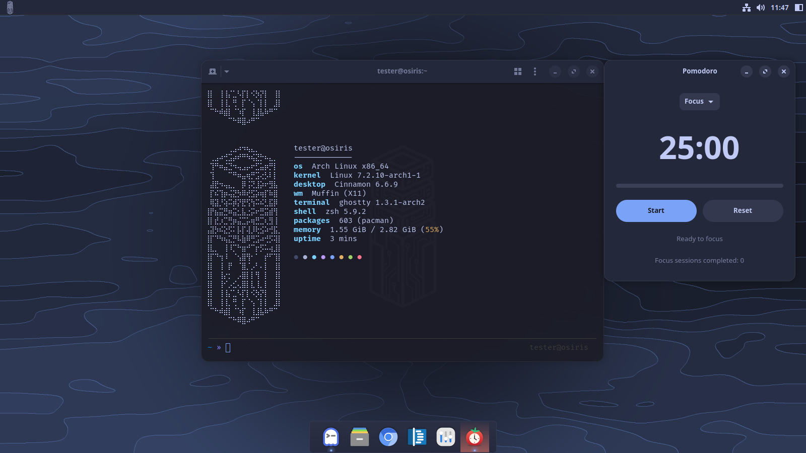
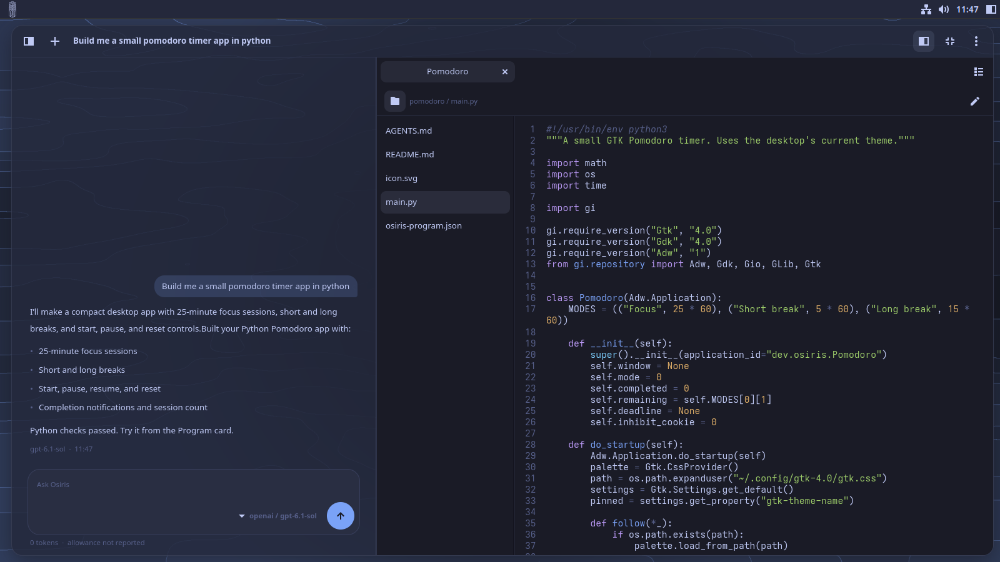
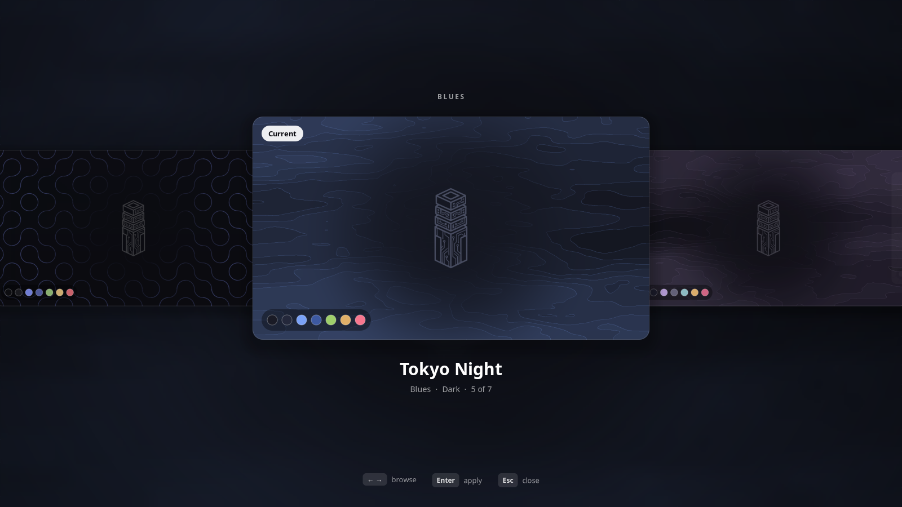
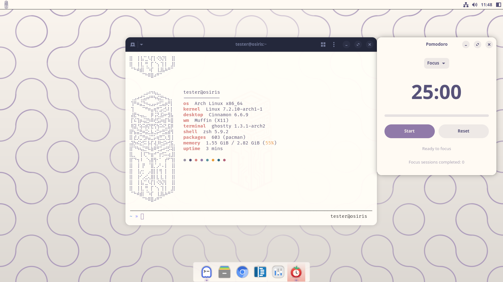
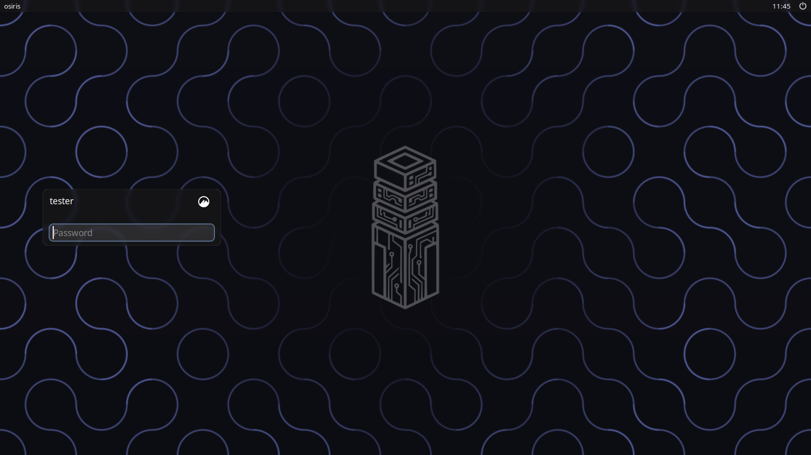

<p align="center">
  <picture>
    <source media="(prefers-color-scheme: dark)" srcset="branding/logo-white.svg">
    
  </picture>
</p>

<h1 align="center">Osiris</h1>

<p align="center">
  A Linux operating system with AI built in.
</p>

<p align="center">
  <a href="https://github.com/alexanderwanyoike/osiris/actions/workflows/ci.yml"></a>
  
  
</p>



**Osiris is a Linux operating system with AI built in.** It's based on Arch
Linux and uses the Cinnamon desktop.

You can ask the AI to change how your desktop looks, or to write small apps for
you. The apps it writes show up in your menu and match your theme. Everything
it makes is saved as normal code on your computer, and you can undo any change
it makes.

Osiris is in early development (alpha).

## The AI

Press Super+A, or the button at the right of the panel, and a sidebar opens
where you can type to the AI. It is called Osiris, like the system.

Ask it for an app, say a Pomodoro timer, and it writes one. A card under its
answer lets you try the app, then install it, which adds it to your
applications menu. From there you can pin it to the dock. It can write apps in
Python, C or C++, Rust, Go or JavaScript.

Ask it for a new look, say "a calm theme for working late", and it makes a
theme and applies it.

After every change there is an Undo button. Undo works without asking the AI
again.

The AI can only do what Osiris allows. It can look around, make changes that
can be undone, and edit the code of the apps it wrote. Anything else it tries
is refused, and you see what it tried.



## Themes

A theme sets the colours of everything at once: apps, window borders, the
panel, the dock, the app launcher, the terminal, folder icons and the
wallpaper. Apps the AI writes follow the theme too. Switching takes effect
straight away, without logging out.

Press Super+T to flip through the themes, and Enter to pick one. Seven come
with Osiris: Osiris Obsidian, Tokyo Night, Nord, Catppuccin Mocha, Rose Pine,
Rose Pine Dawn and Everforest. You can make your own in the Appearance app,
starting from a colour or a picture, or ask the AI for one.





## Your code and settings

Each app the AI writes is a folder in `~/Code`, kept in git, so you can see
every change it made. You can open it in any editor or carry on with another
coding tool. Uninstalling an app leaves its code where it is.

The AI runs through [opencode](https://opencode.ai). You connect it to the AI
provider you want, with your own account or key.

Updating Osiris doesn't overwrite your theme, your dock, your terminal settings
or files you have edited.

Osiris is open source, under the GPL.

## Installing

The ISO starts a live session of the full desktop, with an Install Osiris icon
on it. It works on both BIOS and UEFI computers. The installer asks for your
region, disk, filesystem, encryption and account, then uses Arch's
[archinstall](https://github.com/archlinux/archinstall) to do the install. You
can wipe a disk or install next to another system (UEFI only), use ext4 or
btrfs, and encrypt the system if you want.



## The stack

| | |
|---|---|
| Base | Arch Linux |
| Desktop | Cinnamon (Muffin, X11), Plank dock, rofi launcher (Super+Space) |
| Login and boot | LightDM with slick-greeter, Plymouth, GRUB, all branded |
| Terminal | ghostty, FiraCode Nerd Font with ligatures |
| Shell | zsh with oh-my-zsh |
| Osiris apps | Appearance, the theme switcher, the AI sidebar and the installer, written in Python with GTK 4 and libadwaita |
| Agent engine | opencode |

## Get it

Osiris is alpha software. It installs and runs, but expect rough edges, and
try it in a virtual machine before trusting it with a disk you care about.

There is no published ISO yet; for now you build it yourself. On an Arch Linux
machine with `archiso` installed:

```bash
python3 iso/repo.py
```

```bash
sudo python3 iso/profile.py
```

The first command builds the `osiris` package as a normal user (makepkg
refuses to run as root). The second builds the ISO into
`build/out/osiris-<version>-x86_64.iso`. It needs root and a network
connection, and takes around half an hour. [INSTALLER.md](docs/INSTALLER.md)
has the details and how to boot the result in QEMU.

## Status

Osiris is alpha. Missing so far:

- Installed systems get Arch updates, but not Osiris updates yet: there is no
  Osiris package repository online.
- Apps the AI writes run with your full user permissions; they are not
  sandboxed. Osiris tells you this before you install one.
- Changing the shape of the desktop (window style, panel and dock layout), not
  just its colours, is planned but not built.

[ROADMAP.md](docs/ROADMAP.md) has the plan.

## How it is built

Osiris doesn't write its own window theme, icon set or desktop components. It
uses existing ones (Cinnamon, Plank, rofi, ghostty, adw-gtk3, Papirus) and
configures them to match. Installing, partitioning and the bootloader are done
by Arch's own tools (archinstall, archiso, pacman), not by Osiris code.

The code is Python, with no shell scripts. It is tested with pytest, ruff,
mypy and import-linter in CI, and the GTK apps are tested headless under Xvfb.

## Documentation

| Document | What it covers |
|---|---|
| [ARCHITECTURE.md](docs/ARCHITECTURE.md) | The stack and why each piece was chosen |
| [THEMING.md](docs/THEMING.md) | How Themes work, how to write one, how the creator works |
| [HARNESS.md](docs/HARNESS.md) | The AI you ask (the Harness, in the code): its tools, what it may do, and why |
| [PROGRAMS.md](docs/PROGRAMS.md) | How Osiris builds, tries and installs Programs |
| [INSTALLER.md](docs/INSTALLER.md) | Building the ISO, the install flow, the guardrails |
| [DEVELOPMENT.md](docs/DEVELOPMENT.md) | Working on Osiris: the VM, the loop, the traps |
| [CONTEXT.md](CONTEXT.md) | The project's language: Theme, Skin, Harness, Program and the rest |
| [docs/adr/](docs/adr) | The architecture decisions, one per file |

## Contributing

Contributions are welcome. [CONTRIBUTING.md](CONTRIBUTING.md) explains the
branch workflow, the checks a pull request has to pass, and the house rules.

## License

Osiris is free software, licensed under the
[GNU General Public License, version 3 or later](LICENSE). You may use, study,
change and share it; if you distribute a changed version, you share your
changes under the same terms.
